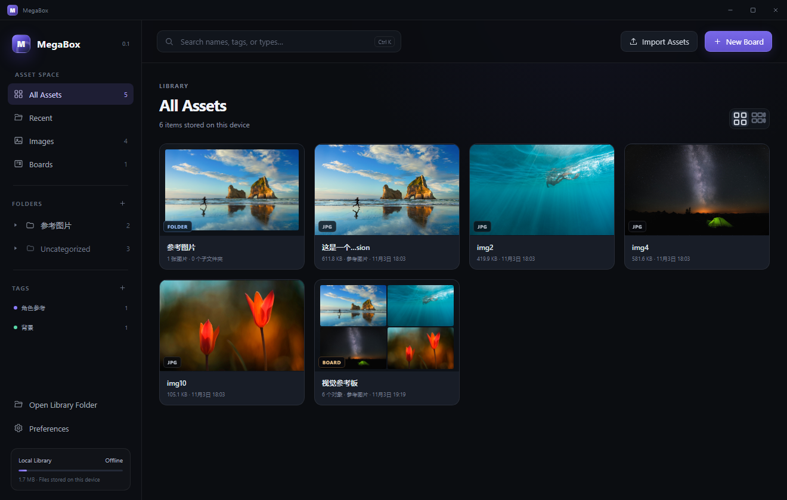
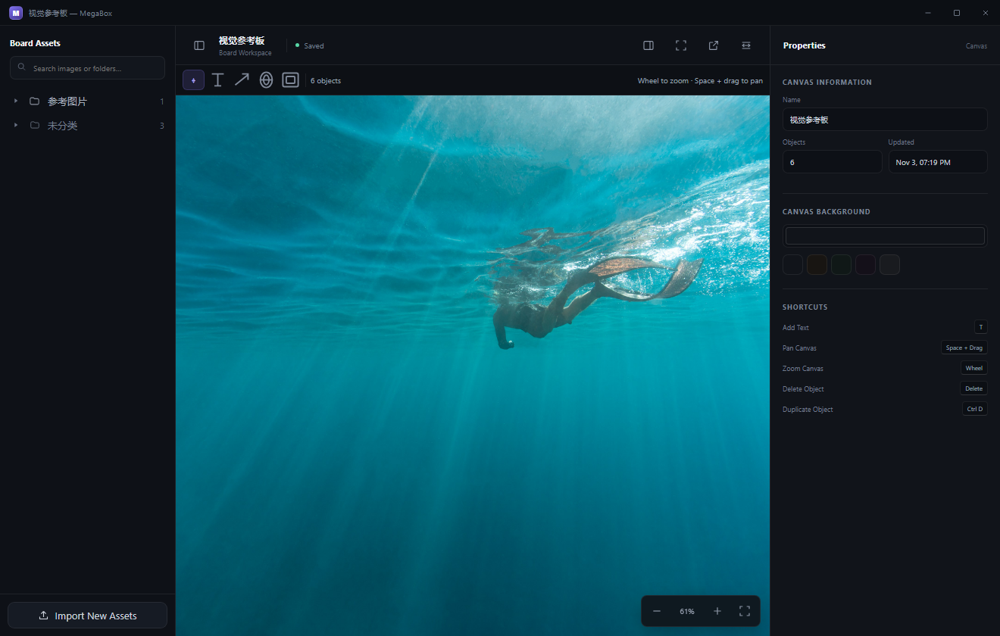
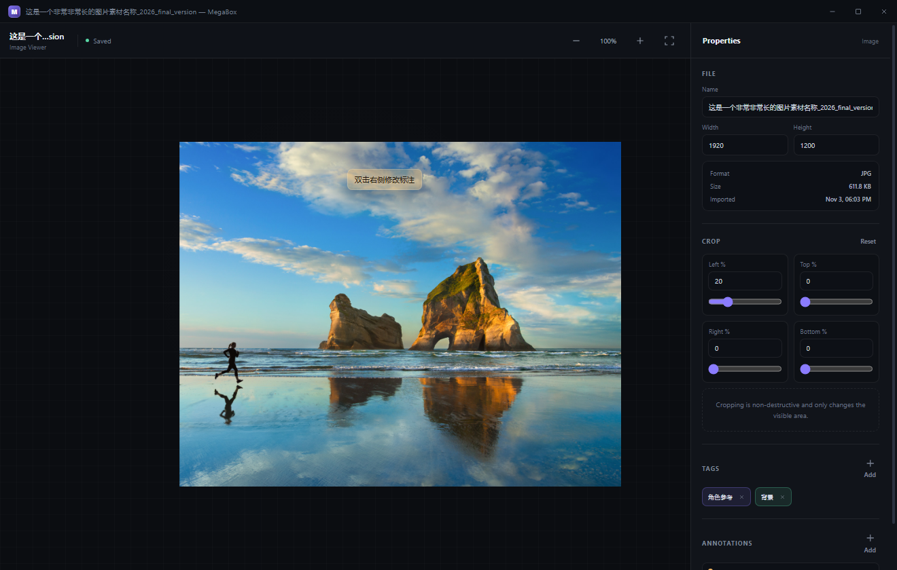
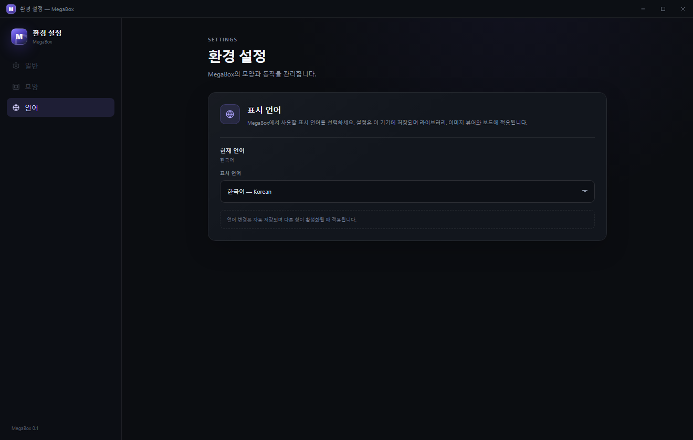

<div align="center">

# MegaBox

**A local-first visual asset library and infinite reference canvas for Windows.**

[简体中文](#简体中文) · [English](#english) · [日本語](#日本語) · [한국어](#한국어)


MegaBox combines the reusable asset management of Eagle with the free-form reference workspace of PureRef.

</div>

---

## Preview

<table>
  <tr>
    <td width="50%"></td>
    <td width="50%"></td>
  </tr>
  <tr>
    <td align="center"><b>Asset library</b></td>
    <td align="center"><b>Reference board</b></td>
  </tr>
  <tr>
    <td width="50%"></td>
    <td width="50%"></td>
  </tr>
  <tr>
    <td align="center"><b>Image viewer</b></td>
    <td align="center"><b>Preferences</b></td>
  </tr>
</table>

## English

MegaBox is an offline Windows desktop application for collecting visual references, organizing them into reusable folders and tags, and arranging them on an infinite reference board.

### Highlights

- **Local and offline:** assets, boards, settings, and thumbnails stay on the local device.
- **Explorer-style library:** nested folders, expandable image nodes, tags, search, Shift multi-selection, marquee selection, select-all, drag reordering, and hover previews.
- **Offline PDF import:** drag large PDFs through memory-safe chunked upload, or import all/selected pages at 75, 150, or 300 DPI with live progress.
- **Image viewer:** center-anchored zoom, panning, non-destructive crop, annotations, opacity, and direct positioning.
- **Infinite canvas:** native-pixel image placement, pan, zoom, multi-select, group movement, rotation, and fixed-size handles.
- **Canvas annotations:** editable text and arrows with colors, opacity, line width, font size, and rotation.
- **Frames:** background frames with dimensions, border, colors, and independent opacity controls.
- **Portal pairs:** create linked A/B-free portals with shared names; double-click one to jump to its pair.
- **Multi-window workflow:** image viewers, boards, and Preferences open in separate app windows.
- **Four interface languages:** Simplified Chinese, English, Japanese, and Korean.

### Run

Requirements:

- Windows 10 or Windows 11
- [.NET 8 Desktop Runtime](https://dotnet.microsoft.com/download/dotnet/8.0)
- Microsoft Edge WebView2 Runtime

Download the latest build from [Releases](../../releases/latest), extract it, and run `MegaBox.exe`.

To build from source:

```powershell
dotnet build .\MegaBox.csproj -c Release
dotnet publish .\MegaBox.csproj -c Release -r win-x64 --self-contained false -o .\publish
.\publish\MegaBox.exe
```

### Local data

The library is stored next to `MegaBox.exe`:

```text
MegaBoxLibrary/
  library.json
  assets/
  thumbnails/
  webview/
```

Original images are copied into `assets`. Back up the whole `MegaBoxLibrary` folder to preserve the library.

### Shortcuts

| Action | Shortcut |
| --- | --- |
| Search library | `Ctrl K` |
| Select all visible assets | `Ctrl A` |
| Add or remove from selection | `Shift + click` |
| Open selected item | `Enter` |
| Pan board | `Space + drag` |
| Zoom board or image | Mouse wheel |
| Proportional image resize | `Shift + drag corner` |
| Add text annotation | `T` |
| Duplicate object | `Ctrl D` |
| Delete object | `Delete` |
| Save board | `Ctrl S` |

---

## 简体中文

MegaBox 是一个本地离线的 Windows 素材管理与参考画布工具，把“可长期复用的素材库”和“自由摆放的参考板”放进同一套工作流。

### 主要功能

- **完全离线：** 素材、画布、设置和缩略图保存在本机。
- **资源管理器式素材库：** 多层文件夹、可展开图片节点、标签、搜索、Shift 多选、框选、全选、拖动排序和悬浮预览。
- **离线 PDF 导入：** 大 PDF 通过分块方式拖入，也可按全部/指定页导入，支持 75、150、300 DPI 和实时进度。
- **图片查看器：** 视角中心缩放、平移、非破坏裁剪、文字标注、透明度和位置调整。
- **无限画布：** 按图片原始像素导入、缩放、平移、框选、整体移动、旋转和固定屏幕尺寸控制点。
- **画布标注：** 可编辑文字和箭头，支持颜色、透明度、线宽、字号和旋转。
- **画框：** 可作为素材底板，设置长宽、旋转、边框、背景颜色和不透明度。
- **传送门：** 每次创建一对同名入口，双击即可跳转到配对入口。
- **多窗口：** 图片、画布和偏好设置分别在独立窗口中打开。
- **四语界面：** 简体中文、English、日本語和한국어。

### 运行

系统要求：

- Windows 10 或 Windows 11
- [.NET 8 Desktop Runtime](https://dotnet.microsoft.com/download/dotnet/8.0)
- Microsoft Edge WebView2 Runtime

从 [Releases](../../releases/latest) 下载最新版本，解压后运行 `MegaBox.exe`。

从源码构建：

```powershell
dotnet build .\MegaBox.csproj -c Release
dotnet publish .\MegaBox.csproj -c Release -r win-x64 --self-contained false -o .\publish
.\publish\MegaBox.exe
```

### 本地数据

素材库位于 `MegaBox.exe` 同目录：

```text
MegaBoxLibrary/
  library.json
  assets/
  thumbnails/
  webview/
```

原图保存在 `assets`。备份整个 `MegaBoxLibrary` 文件夹即可完整备份素材库。

### 常用快捷键

| 操作 | 快捷键 |
| --- | --- |
| 搜索素材 | `Ctrl K` |
| 全选当前视图素材 | `Ctrl A` |
| 增加或取消选择 | `Shift + 单击` |
| 打开选中项目 | `Enter` |
| 平移画布 | `Space + 拖动` |
| 缩放画布或图片 | 鼠标滚轮 |
| 等比缩放图片 | `Shift + 拖动缩放角` |
| 添加文字标注 | `T` |
| 复制对象 | `Ctrl D` |
| 删除对象 | `Delete` |
| 保存画布 | `Ctrl S` |

---

## 日本語

MegaBox は、Windows 向けのローカル・オフライン型ビジュアルアセットライブラリ兼リファレンスキャンバスです。再利用できる素材管理と、自由に配置できる参考ボードを一つにまとめています。

### 主な機能

- **完全ローカル：** アセット、ボード、設定、サムネイルは端末内に保存されます。
- **エクスプローラー形式のライブラリ：** 階層フォルダー、画像ノード、タグ、検索、Shift 複数選択、範囲選択、すべて選択、ドラッグ並べ替え、ホバープレビュー。
- **オフライン PDF インポート：** 大きな PDF は分割転送でドロップし、全ページまたは指定ページを 75・150・300 DPI でインポートできます。進捗も表示します。
- **画像ビューア：** 中心基準のズーム、パン、非破壊トリミング、テキスト注釈、透明度、位置調整。
- **無限キャンバス：** 元画像のピクセルサイズで配置、ズーム、パン、範囲選択、グループ移動、回転、固定サイズの操作ハンドル。
- **キャンバス注釈：** 編集可能なテキストと矢印。色、透明度、線幅、フォントサイズ、回転に対応。
- **フレーム：** 素材の下に敷ける背景フレーム。サイズ、枠線、背景色、透明度を設定可能。
- **ポータル：** 同じ名前を持つ一対の入口を作成し、ダブルクリックで相方へ移動。
- **マルチウィンドウ：** 画像、ボード、環境設定を独立したウィンドウで表示。
- **4 言語対応：** 簡体字中国語、英語、日本語、韓国語。

### 実行方法

動作環境：

- Windows 10 または Windows 11
- [.NET 8 Desktop Runtime](https://dotnet.microsoft.com/download/dotnet/8.0)
- Microsoft Edge WebView2 Runtime

[Releases](../../releases/latest) から最新版をダウンロードし、展開して `MegaBox.exe` を起動してください。

ソースからビルドする場合：

```powershell
dotnet build .\MegaBox.csproj -c Release
dotnet publish .\MegaBox.csproj -c Release -r win-x64 --self-contained false -o .\publish
.\publish\MegaBox.exe
```

### ローカルデータ

ライブラリは `MegaBox.exe` と同じフォルダーに保存されます。

```text
MegaBoxLibrary/
  library.json
  assets/
  thumbnails/
  webview/
```

元画像は `assets` に保存されます。`MegaBoxLibrary` フォルダー全体をバックアップしてください。

### ショートカット

| 操作 | ショートカット |
| --- | --- |
| ライブラリ検索 | `Ctrl K` |
| 現在のビューをすべて選択 | `Ctrl A` |
| 選択に追加・選択解除 | `Shift + クリック` |
| 選択項目を開く | `Enter` |
| キャンバス移動 | `Space + ドラッグ` |
| キャンバス／画像のズーム | マウスホイール |
| 画像を比率維持でサイズ変更 | `Shift + 角をドラッグ` |
| テキスト注釈を追加 | `T` |
| オブジェクトを複製 | `Ctrl D` |
| オブジェクトを削除 | `Delete` |
| ボードを保存 | `Ctrl S` |

---

## 한국어

MegaBox는 Windows용 로컬 오프라인 비주얼 에셋 라이브러리이자 무한 참고 보드입니다. 재사용 가능한 에셋 관리와 자유로운 레퍼런스 배치를 하나의 작업 흐름으로 결합합니다.

### 주요 기능

- **완전 오프라인:** 에셋, 보드, 설정과 썸네일이 이 기기에 저장됩니다.
- **탐색기형 라이브러리:** 중첩 폴더, 펼칠 수 있는 이미지 노드, 태그, 검색, Shift 다중 선택, 범위 선택, 모두 선택, 드래그 순서 변경과 마우스 오버 미리보기.
- **오프라인 PDF 가져오기:** 큰 PDF는 분할 전송으로 드롭하고 전체/지정 페이지를 75·150·300 DPI로 가져올 수 있으며 실시간 진행률을 표시합니다.
- **이미지 뷰어:** 화면 중심 기준 확대/축소, 이동, 비파괴 자르기, 텍스트 주석, 불투명도와 위치 조정.
- **무한 캔버스:** 원본 픽셀 크기로 배치, 확대/축소, 이동, 범위 선택, 그룹 이동, 회전과 고정 크기 핸들.
- **캔버스 주석:** 편집 가능한 텍스트와 화살표. 색상, 불투명도, 선 너비, 글꼴 크기와 회전 지원.
- **프레임:** 에셋 아래에 배치하는 배경 프레임. 크기, 테두리, 배경색과 불투명도 설정.
- **포털:** 같은 이름을 공유하는 포털 한 쌍을 만들고, 두 번 클릭하여 반대편으로 이동.
- **다중 창:** 이미지, 보드와 환경 설정을 각각 독립된 창에서 엽니다.
- **4개 언어:** 중국어(간체), English, 日本語, 한국어.

### 실행 방법

필요 환경:

- Windows 10 또는 Windows 11
- [.NET 8 Desktop Runtime](https://dotnet.microsoft.com/download/dotnet/8.0)
- Microsoft Edge WebView2 Runtime

[Releases](../../releases/latest)에서 최신 버전을 내려받아 압축을 풀고 `MegaBox.exe`를 실행하세요.

소스에서 빌드:

```powershell
dotnet build .\MegaBox.csproj -c Release
dotnet publish .\MegaBox.csproj -c Release -r win-x64 --self-contained false -o .\publish
.\publish\MegaBox.exe
```

### 로컬 데이터

라이브러리는 `MegaBox.exe`와 같은 폴더에 저장됩니다.

```text
MegaBoxLibrary/
  library.json
  assets/
  thumbnails/
  webview/
```

원본 이미지는 `assets`에 저장됩니다. `MegaBoxLibrary` 폴더 전체를 백업하면 라이브러리를 보존할 수 있습니다.

### 단축키

| 작업 | 단축키 |
| --- | --- |
| 라이브러리 검색 | `Ctrl K` |
| 현재 보기의 모든 항목 선택 | `Ctrl A` |
| 선택 항목 추가·해제 | `Shift + 클릭` |
| 선택 항목 열기 | `Enter` |
| 캔버스 이동 | `Space + 드래그` |
| 캔버스/이미지 확대·축소 | 마우스 휠 |
| 이미지 비율 유지 크기 조정 | `Shift + 모서리 드래그` |
| 텍스트 주석 추가 | `T` |
| 객체 복제 | `Ctrl D` |
| 객체 삭제 | `Delete` |
| 보드 저장 | `Ctrl S` |

---

## Architecture

```text
MainWindow.xaml              WPF application shell
MainWindowHost.cs            WebView2 host, window bridge, local commands
Services/LibraryStore.cs     Asset import, deduplication, local persistence
www/index.html               Single-page application entry
www/styles.css               Library, viewer, board, and Preferences UI
www/app.js                   Library, canvas, window, and i18n logic
docs/screenshots/            README screenshots
```

- **Desktop shell:** WPF + custom WindowChrome
- **UI runtime:** WebView2
- **Frontend:** HTML, CSS, vanilla JavaScript
- **Storage:** external asset files + `library.json`
- **Platform:** Windows 10/11, x64

## Contributing

- Search existing Issues before opening a new one.
- Keep bug reports reproducible and include the application version.
- Keep pull requests focused and describe the affected window or workflow.
- Do not include private images, personal library data, or credentials in Issues or pull requests.

## License

**简体中文：** 本项目源代码采用 [MIT License](LICENSE)。第三方运行时、组件及素材仍遵循各自协议。  
**English:** Source code is released under the [MIT License](LICENSE). Third-party runtimes, components, and assets remain subject to their own licenses.  
**日本語：** 本プロジェクトのソースコードは [MIT License](LICENSE) で公開されています。サードパーティのランタイム、コンポーネント、素材にはそれぞれのライセンスが適用されます。  
**한국어:** 이 프로젝트의 소스 코드는 [MIT License](LICENSE)로 배포됩니다. 타사 런타임, 구성 요소 및 에셋에는 각각의 라이선스가 적용됩니다.

## Disclaimer

MegaBox is an independent project and is not affiliated with Eagle or PureRef.
